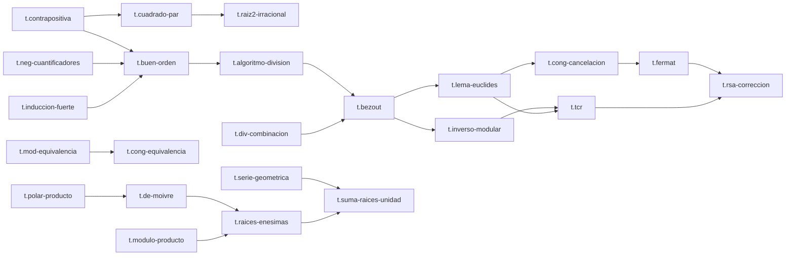

# El Códice de Álgebra — Documento de diseño (Fase 0)

Estado: **borrador para revisión**. No hay código todavía. Este documento fija la arquitectura, el modelo de datos, el flujo de una sesión, el esquema de un ejercicio y el árbol de dependencias de los Mundos 1 y 2. Al final (§12) hay decisiones que necesito que confirmes antes de programar.

Nombre de trabajo: **El Códice de Álgebra**. «Códice» es el libro de teoremas que el jugador va llenando y que luego usa como herramienta.

---

## 1. Principios que ordenan todo lo demás

1. **Se avanza demostrando, no jugando.** Ninguna recompensa abre contenido por sí sola: abre contenido el dominio (§6.3).
2. **Los teoremas son herramientas.** Un teorema entra al Códice al demostrarse y solo entonces puede citarse (§5).
3. **Nada de texto libre calificado.** Todo se corrige con verificadores exactos, grafos de dependencias o autoevaluación contra respuesta modelo.
4. **El contenido es dato; el motor no sabe de álgebra.** Los ejercicios son generadores con semilla que declaran su verificador; el motor solo los orquesta.
5. **Las instancias se construyen hacia atrás** (se elige la respuesta, luego el enunciado) para que los números sean razonables.
6. **Sin red.** Un solo HTML, KaTeX y fuentes incrustados, funciona desde `file://`.
7. **Honestidad matemática.** Cada teorema y demostración sale listado en `docs/revision-matematica.md` con hipótesis y dependencias. Las pruebas automáticas validan la *consistencia* (el grafo, el orden, los verificadores), no que el contenido sea correcto: eso lo revisas tú.

---

## 2. Arquitectura

### 2.1 Capas

```
 núcleo matemático  ──►  motor de ejercicios  ──►  motor de aprendizaje  ──►  interfaz
 (core/)                 (engine/ejercicio…)       (engine/dominio…)          (ui/)
        ▲                        ▲
        └──────── contenido por mundo (content/) ─────── solo datos + generadores
```

- **Núcleo matemático** (`core/`): aritmética exacta. No depende de nada. Se prueba solo.
- **Motor de ejercicios**: instancia generadores con semilla, corrige con verificadores, calcula firmas de error, modela demostraciones como grafos.
- **Motor de aprendizaje**: dominio, desvanecimiento, Leitner, planificador, XP, estrellas, Códice, logros. Puro (sin DOM), por eso se prueba en Node.
- **Interfaz**: vistas, teclado matemático, grillas, arrastre, sonido, tema. Es la única capa que toca el DOM, `localStorage` y Web Audio.
- **Contenido**: depende del núcleo y de las interfaces del motor; el motor nunca importa contenido (lo recibe registrado).

### 2.2 Estructura de carpetas

```
algebra-codice/
  build.js                  genera index.html (único, sin red)
  index.html                salida de build.js (se publica)
  src/
    manifest.js             orden de carga de archivos; lo leen build.js y tools/test.js
    index.template.html
    style.css               tokens de tema, claro/oscuro, reduced-motion
    vendor/katex/           katex.min.js, katex.min.css (sin @font-face), fuentes woff2 usadas
    fonts/                  EB Garamond (títulos) + sans de interfaz (woff2, subconjunto latino)
    core/
      rng.js                PRNG con semilla (xmur3 + mulberry32), ayudantes (int, pick, shuffle, coprimos…)
      rat.js                racionales con BigInt
      zp.js                 aritmética en ℤ_p
      cx.js                 complejos exactos (§3.2)
      poly.js               polinomios sobre ℚ, ℤ_p, ℚ(i)
      mat.js                matrices y vectores sobre un cuerpo
      numth.js              mcd, Bézout, factorización, φ, potencia modular
      logic.js              fórmulas proposicionales: parser, evaluación, tablas, equivalencia
      sets.js               conjuntos y relaciones finitas
      expr.js               tokenizador/parser de entrada del jugador → AST → forma normal
    engine/
      schema.js             validación de la forma de generadores, demostraciones, teoremas
      ejercicio.js          instanciar(generador, semilla), variantKey
      verificar.js          registro de verificadores
      errores.js            firmas de error y retroalimentación
      demostracion.js       grafo de líneas, orden válido, modos derivados (§4.4)
      dominio.js            ventana de 10, deduplicado, regla de dominio
      desvanecer.js         escalones por teorema
      leitner.js            cajas 1–5, intervalos 1/3/7/16/35
      planificador.js       elige el próximo ejercicio (§7)
      xp.js                 XP, nivel de jugador, rendimientos decrecientes
      codice.js             teoremas ganados, disponibilidad, grafo de habilidades
      jefe.js               fases, vida, derrota → repaso dirigido
      reto-diario.js        desafío del día con la fecha como semilla
      logros.js
      guardado.js           esquema versionado, migraciones, exportar/importar, respaldo en memoria
    ui/
      app.js  rutas  vistas/*.js  teclado-mate.js  grilla.js  arrastre.js
      katex.js (envoltura: render + MathML)  sonido.js  tema.js  a11y.js  panel.js
    content/
      index.js              registra mundos
      habilidades.js        catálogo de habilidades (todas)
      teoremas.js           catálogo de teoremas (todos), con `requiere`
      w1/ mundo.js  n1-logica.js  n2-cuantificadores.js  …  jefe.js
      w2/ …
      w3..w8/ mundo.js      sólo metadatos: estado «en construcción»
  tools/
    test.js                 criterios de aceptación 1 y 2
    auditar.js              genera docs/revision-matematica.md
    humo.md                 lista de verificación del navegador (375 y 1280 px)
  docs/
    diseno.md  revision-matematica.md  agregar-contenido.md
```

### 2.3 Módulos sin bundler

Mismo patrón que mis otros juegos: **scripts clásicos concatenados**, cada archivo es un IIFE que cuelga de `globalThis.AC` y, si existe `module`, también exporta. `src/manifest.js` es la única lista de orden; `build.js` y `tools/test.js` la leen, así Node y el navegador ejecutan exactamente el mismo código. `build.js` aborta si algún archivo contiene `</script`.

### 2.4 Construcción (`node build.js`)

1. Lee `manifest.js`, concatena el JS en un solo `<script>`.
2. Incrusta `style.css`, KaTeX (CSS con sus `@font-face` reescritos a `data:font/woff2;base64,…`), las fuentes de interfaz y el JS de KaTeX.
3. Escribe `index.html`. Falla si el resultado contiene `http://` o `https://` en `src`/`href`/`url(` (garantía de «sin red»).
4. Presupuesto de tamaño: ≤ 2,5 MB tras la Fase 1; ≤ 5 MB al final. Para KaTeX se incrustan solo las fuentes woff2 que se usan (Main, Math, AMS, Size1–4, Caligraphic, SansSerif; se verifica con la tabla de símbolos que usa el contenido).
5. **KaTeX**: versión 0.16.22 (la que ya tengo en `claude-motion/node_modules`). Opciones: `output: 'htmlAndMathml'`, `throwOnError: false`, `trust: false`, `strict: 'warn'`.
6. **Fuentes**: EB Garamond (OFL) para títulos y una sans legible (Source Sans 3 o Inter, OFL) para interfaz. Se descargan **una sola vez**, se subconjuntan a latín + signos usados y se versionan en `src/fonts/`. Riesgo: las pesadas pueden empujar el tamaño; se subconjuntan.

### 2.5 Pruebas

- `node tools/test.js` (sin dependencias, Node ≥ 18): carga el mismo `manifest`, recorre el contenido registrado y aplica §9 criterios 1 y 2. Imprime el resumen por generador y devuelve código ≠ 0 si algo falla.
- `node tools/auditar.js`: recorre teoremas y demostraciones y genera `docs/revision-matematica.md` (la parte mecánica; las dudas las escribo yo a mano en un bloque «Dudas» que el script conserva).
- Verificación en navegador real (criterio 3): lista en `tools/humo.md`, ejecutada con el navegador integrado a 375 px y 1280 px; reviso consola y red; recargo; exporto/importo.

---

## 3. Núcleo matemático

Todo exacto, sin `Number` para valores que no sean contadores pequeños. **No se usa math.js.**

### 3.1 Racionales (`rat.js`)
`Rat{n:BigInt, d:BigInt}` siempre reducido, `d>0`. Operaciones, comparación, `parse` que acepta `3,5`, `3.5`, `7/2`, `-2/4`, y `format`. La entrada decimal se convierte a racional exacto (`0,125 → 1/8`); un decimal periódico no es válido (se avisa «escribe la fracción»).

### 3.2 Complejos exactos (`cx.js`)
Un cálculo exacto con ángulos arbitrarios exige números algebraicos generales. Decisión de alcance:

- **Cuerpo base de coordenadas**: `K = ℚ(√2, √3)`, con base `{1, √2, √3, √6}` y coeficientes `Rat`. Cubre `cos` y `sen` de todos los múltiplos de π/12 (por ejemplo `sen(π/12) = (√6−√2)/4`).
- `Cx{re:K, im:K}` para binomiales; aritmética completa; módulo al cuadrado (en `K`); conjugado; inverso.
- **Forma polar**: `Polar{r: K≥0 con r² ∈ ℚ…, theta: Rat}` donde `theta` es el múltiplo racional de π (módulo 2). Los generadores del Mundo 2 usan `r` entero o `r = a√b` y ángulos con denominador que divide a 12; las raíces n-ésimas piden forma polar (θ = (θ₀+2πk)/n **como fracción de π**), por lo que **no necesitan trigonometría numérica**.
- Igualdad de polares: mismos módulos y `theta` congruentes módulo 2 (el verificador acepta cualquier representante, y dice si esperaba el argumento principal en `(−π, π]`).
- Limitación declarada: no se pide `cos` de ángulos que no sean múltiplos de π/12 en forma binomial. Si un día hace falta, se amplía `K` con otra extensión; el resto del código no cambia porque `K` es una interfaz de cuerpo.

### 3.3 Polinomios (`poly.js`) — Mundo 3, pero la interfaz se fija ya
Polinomios univariados sobre un `Cuerpo` (`ℚ`, `ℤ_p`, `ℚ(i)`); multivariados mínimos para el CAS de equivalencia (§3.7). División, mcd, evaluación (Horner), derivada, factorización sobre ℚ por: contenido y primitiva, raíces racionales, Kronecker/Zassenhaus-lite para grado ≤ 6, irreducibilidad por reducción módulo primos pequeños. Sobre ℝ solo `grado ≤ 2` es irreducible; sobre ℂ solo `grado 1`.

### 3.4 Matrices (`mat.js`) — Mundo 4
Genéricas sobre un `Cuerpo`: operaciones, eliminación gaussiana con registro de operaciones elementales (la usa el ejercicio paso a paso), rango, inversa, determinante, espacio nulo, valores propios racionales.

### 3.5 Cuerpos
Interfaz común: `zero, one, add, sub, mul, div, neg, inv, eq, isZero, parse, format, rand(rng)`. Implementaciones: `QQ`, `QI` (ℚ(i)), `Zp(p)`. «Espacios vectoriales sobre ℝ y ℂ»: **todo cálculo del juego usa ℚ en lugar de ℝ y ℚ(i) en lugar de ℂ**; los enunciados dicen «sobre ℝ» cuando lo que importa es la teoría, y los datos son racionales. Es una convención declarada en el Códice (ver §12.1, punto 3).

### 3.6 Teoría de números (`numth.js`)
`mcd`, `mcm`, Euclides extendido (con la tabla de pasos para el ejercicio guiado), inverso modular, potencia modular, criba, factorización por tentativa, `φ`, TCR para dos módulos, generación de coprimos y de primos pequeños. Todo en `BigInt`.

### 3.7 Entrada del jugador y equivalencia (`expr.js`, `logic.js`)
- Gramática única con `+ − × · / ^`, paréntesis, `√`, `π`, `i`, variables, `sin/cos` (solo cuando haga falta), fracciones `a/b`, decimal con coma o punto. Cada tecla de la pantalla inserta un token y el campo acepta también teclado físico (`*`→`×`, `sqrt(`→`√(`).
- **La vista previa KaTeX se renderiza desde el AST ya parseado**, no desde el texto crudo. Si no parsea, el mensaje señala la posición («falta cerrar el paréntesis»), nunca «respuesta incorrecta».
- Forma normal: polinomio multivariado en `ℚ[x,y,…]` (con `i` como extensión y `√` solo sobre racionales positivos). Equivalencia = igualdad de formas normales. Las formas que importan se verifican aparte (§4.3).
- Fórmulas lógicas: sintaxis `¬ ∧ ∨ → ↔` con teclas dedicadas, evaluación y tabla de verdad; equivalencia por tabla; formas normales opcionales.

---

## 4. Ejercicios

### 4.1 Dos familias, un contrato

Todo ejercicio es **un generador** `Gen` registrado en un nivel. Un generador devuelve, dada una semilla, una **instancia** completa y autocontenida. Hay dos familias:

| Familia | Qué produce | Cómo se corrige |
|---|---|---|
| **aplicación** | enunciado + tipo de respuesta + respuesta(s) correctas | `verificar(inst, respuesta)` |
| **demostración** | un objeto `Demostración` (§4.4) + un **modo** | grafo de dependencias; el modo decide qué se le pide |

### 4.2 Esquema de un generador (aplicación)

```js
AC.registrar.generador({
  id: 'w2.n2.bezout-coef',           // único; w<mundo>.n<nivel>.<slug>
  mundo: 2, nivel: 2,
  familia: 'aplicacion',
  habilidades: ['2.2.bezout'],       // una o varias (§6.1)
  requiere: ['t.bezout'],            // teoremas que el ejercicio PRESUPONE conocidos
  dificultad: 2,                     // 1..3
  confianza: true,                   // puede pedir baja/media/alta
  autoexplicacion: 'bezout-metodo',  // id de un banco de opciones (opcional)

  generar(rng, nivelDificultad) {    // CONSTRUIR HACIA ATRÁS
    const d = rng.pick([1, 2, 3, 4, 5, 6]);
    const [x, y] = rng.pareCoprimos(2, 12);   // x,y coprimos
    const a = d * x, b = d * y;
    return {
      variantKey: `${a},${b}`,       // repetir esta clave en la ventana cuenta una vez
      params: { a, b, d },
      enunciado: tpl`Halla enteros $x,y$ tales que $${a}x+${b}y=\operatorname{mcd}(${a},${b})$.`,
      entrada: { tipo: 'tupla', n: 2, campos: ['x', 'y'], dominio: 'Z' },
      verificador: { id: 'combinacion-lineal', args: { a, b, objetivo: d } },
      mostrarEnEnunciado: ['a', 'b'],   // lo único que puede aparecer; lo usa el chequeo «el enunciado no trae la respuesta»
      firmas: [                         // errores típicos CALCULADOS para esta instancia
        { id: 'signo',        respuesta: [-x0, -y0],  mensaje: 'Cambiaste el signo de ambos coeficientes: comprueba $ax+by$ con tus valores.' },
        { id: 'resto-no-mcd', respuesta: [..],         mensaje: 'Esa combinación da el último resto distinto de cero …' },
        { id: 'coef-cruzados',respuesta: [y0, x0],     mensaje: 'Intercambiaste $x$ e $y$.' },
      ],
      pistas: [
        'Orientación: ¿qué algoritmo calcula el mcd y deja un rastro de restos?',
        'Idea clave: despeja cada resto y sustituye hacia atrás.',
        'Primer paso: escribe $' + a + '=' + b + '\\cdot q_1+r_1$.',
      ],
      explicacion: tpl`…solución completa paso a paso…`,
    };
  },
});
```

Reglas del esquema (las revisa `engine/schema.js` al cargar y `tools/test.js` en profundidad):

- **Determinismo**: misma `semilla` ⇒ misma instancia. La semilla se compone de `(generadorId, semillaDePartida, contador)`. Jamás se usa `Math.random`.
- **`variantKey`** identifica la *variante estructural*, no la semilla. Si dos semillas producen el mismo `variantKey`, para el dominio son el mismo ejercicio.
- **`firmas`**: lista de errores típicos. Cada firma lleva la respuesta equivocada **calculada con los parámetros de la instancia** (no un texto genérico) y un mensaje. La corrección compara la respuesta del jugador con cada firma usando el mismo criterio de equivalencia que el verificador; si coincide, muestra el mensaje específico y registra el error tipificado (alimenta «conceptos débiles»). Una firma cuya respuesta es *igual* a la correcta, o duplicada, es un error de contenido que el test detecta.
- **`mostrarEnEnunciado`** y `entrada.tipo` permiten el chequeo automático «el enunciado no trae la respuesta» (§9).
- **Pistas**: siempre tres, en orden orientación → idea clave → primer paso. Reducen XP (§8.1), no bloquean.
- **`requiere`** impide que el ejercicio se ofrezca antes de que sus teoremas estén en el Códice (§5.3).

### 4.3 Tipos de respuesta y verificadores

Cada generador declara `entrada` y `verificador`. Registro inicial:

| `entrada.tipo` | Control | Verificadores típicos |
|---|---|---|
| `racional`, `entero` | campo + teclado | `igual-racional`, `entero-en` |
| `expr` | campo + teclado + vista previa KaTeX | `equivalente-expr`, `forma-reducida`, `factorizacion(cuerpo)`, `forma-polinomio` |
| `complejo` | campo (binomial) o par (módulo, argumento/π) | `igual-complejo`, `polar-equivalente` |
| `conjunto`, `lista` | campo de elementos o fichas | `igual-conjunto`, `igual-multiconjunto` |
| `tupla` | n campos | `combinacion-lineal`, `satisface(pred)` |
| `matriz`, `vector` | **grilla editable** | `igual-matriz`, `base-de(V)` (independencia + generación), `vector-propio(A, λ)` hasta múltiplo escalar |
| `tabla` | grilla de V/F | `tabla-de-verdad` |
| `eleccion`, `multiple` | botones | `indice-correcto`, `conjunto-de-indices` |
| `procedimiento` | el jugador elige cada operación; el juego la aplica y muestra el estado | `ruta-valida` (cualquier secuencia que llegue a la meta cumpliendo las reglas), con límite opcional de pasos |
| `construccion` | el jugador construye un objeto | `satisface(pred)` (contraejemplos: el juego evalúa el predicado) |

Principios:

1. **La equivalencia no basta si la forma importa.** «Factoriza» exige producto de factores *irreducibles en el cuerpo indicado*; «simplifica» exige forma reducida (fracción en términos mínimos, sin radicales anidados evitables, polinomio expandido y ordenado según se pida). Cada verificador declara qué forma exige y el mensaje distingue «es equivalente pero no está en la forma pedida» de «no es equivalente».
2. **Varias respuestas válidas ⇒ se verifican propiedades**: una base, por independencia y generación; un vector propio, hasta múltiplo escalar no nulo; Bézout, por `ax+by=d`; la solución particular de una diofántica, por sustitución; un contraejemplo, evaluando el predicado.
3. **Procedimientos paso a paso**: el estado es un valor del núcleo (matriz, tabla de Euclides, fórmula lógica). Cada «operación» es una función pura declarada en el generador; el juego aplica la elegida y vuelve a mostrar el estado. Se acepta cualquier ruta que cumpla el `predicado-meta`; si hay una ruta óptima, se compara pero no se exige.
4. **Contextos** (criptografía modular, rotaciones, circuitos, cadenas de Markov) son *habillados* de un generador: el mismo verificador, enunciado distinto. Los listados por nivel están en §11.2 y §11.3.

### 4.4 Demostraciones: el objeto `Demostración`

Una demostración **no** es texto: es un grafo.

```js
AC.registrar.demostracion({
  id: 'dem.cuadrado-par.contrapositiva',
  teorema: 't.cuadrado-par',            // si prueba un teorema que entra al Códice
  // o: tipo: 'enunciado' para proposiciones de práctica que no entran al Códice
  mundo: 1, nivel: 5,
  habilidades: ['1.5.contrapositiva', '1.5.paridad'],
  requiere: ['t.contrapositiva', 't.paridad-operaciones'],   // ⊆ Códice al ofrecerse

  parametros(rng) {                      // varía NOMBRES y DATOS, no sólo el orden
    return { n: rng.pick(['n', 'm', 'k']), k: rng.pick(['k', 'j', 'q']) };
  },
  enunciado: tpl`Sea $${n}\in\mathbb{Z}$. Si $${n}^2$ es par, entonces $${n}$ es par.`,
  hipotesis: [tpl`$${n}\in\mathbb{Z}$`, tpl`$${n}^2$ es par`],
  meta: tpl`$${n}$ es par`,

  lineas: [                              // nodos del grafo
    { id: 'L1', texto: tpl`Probamos la contrapositiva: si $${n}$ es impar, $${n}^2$ es impar.`,
      just: { tipo: 'teorema', ref: 't.contrapositiva' }, deps: [] },
    { id: 'L2', texto: tpl`Sea $${n}$ impar: $${n}=2${k}+1$ para algún $${k}\in\mathbb{Z}$.`,
      just: { tipo: 'definicion', ref: 'd.impar' }, deps: ['L1'] },
    { id: 'L3', texto: tpl`Entonces $${n}^2=4${k}^2+4${k}+1=2(2${k}^2+2${k})+1$.`,
      just: { tipo: 'algebra', ref: 'b.cuerpo' }, deps: ['L2'] },
    { id: 'L4', texto: tpl`Como $2${k}^2+2${k}\in\mathbb{Z}$, $${n}^2$ es impar.`,
      just: { tipo: 'definicion', ref: 'd.impar' }, deps: ['L3'] },
    { id: 'L5', texto: tpl`Luego, si $${n}^2$ es par, $${n}$ es par. ∎`,
      just: { tipo: 'teorema', ref: 't.contrapositiva' }, deps: ['L1', 'L4'] },
  ],
  orden_referencia: ['L1', 'L2', 'L3', 'L4', 'L5'],   // una de las válidas; el test la comprueba

  distractores: [                        // líneas fuera del grafo, con la razón por la que fallan
    { texto: tpl`Como $${n}^2$ es par, $${n}^2=2${k}$, luego $${n}=2\sqrt{${k}}$.`, falla: 'asume que $\\sqrt{k}$ es entero' },
    { texto: tpl`Probamos el recíproco: si $${n}$ es par, $${n}^2$ es par.`, falla: 'confunde recíproco con contrapositiva' },
  ],
  errores: [                             // para «cazar el error»: una línea mala sustituye a una buena
    { sustituye: 'L3', texto: tpl`Entonces $${n}^2=2${k}^2+1$.`,
      diagnostico: 'error-de-calculo', opciones: ['error-de-calculo','circular','no-justificado','caso-faltante'] },
  ],
  estrategias: [                         // «elegir estrategia»: todas las válidas se aceptan y se comparan
    { id: 'contrapositiva', valida: true,  nota: 'Directa a un enunciado equivalente; la más corta.' },
    { id: 'contradiccion',  valida: true,  nota: 'Supón $n$ impar y $n^2$ par …' },
    { id: 'directa',        valida: false, nota: 'Partir de $n^2=2k$ no permite despejar $n$ sin ya saber lo que se prueba.' },
    { id: 'induccion',      valida: false, nota: 'No hay estructura recursiva en la hipótesis.' },
  ],
  modelo: tpl`…respuesta modelo para redactar y autoevaluarse (§4.6)…`,
});
```

**Semántica del grafo.**

- `deps` de una línea son las líneas que debe tener *antes* (premisas que usa). Un orden de líneas del jugador es válido ⇔ es un orden topológico del subgrafo que eligió **y** el subgrafo contiene todas las líneas del grafo (o todas las necesarias para llegar a la meta, según el modo). Se acepta cualquier orden que respete las aristas; no hay «un» orden correcto.
- `just.tipo` ∈ `hipotesis | definicion | teorema | propiedad-base | algebra | logica | induccion`. `just.ref` apunta a una definición, a una propiedad base (§5.1) o a un teorema del Códice.
- **Uso circular** se detecta estructuralmente: una línea cuya justificación sea el propio teorema que se demuestra (o un teorema que depende de él) es circular. Es una firma de error de todas las demostraciones.
- **Validación de contenido** (en `tools/test.js`): todos los `ref` de teorema ∈ `requiere` ∪ cierre transitivo de sus `requiere`; el grafo es acíclico; `orden_referencia` es topológico; los `distractores` no tienen id ni aparecen en ningún `deps`; los `errores` sustituyen líneas existentes.

**Modos derivados de una misma demostración** (cada modo es una proyección del objeto, sin escribir contenido nuevo):

| Modo | Se le muestra | Se le pide | Corrige |
|---|---|---|---|
| `ordenar` | líneas barajadas + distractores | ordenar y descartar | orden topológico + distractores fuera |
| `justificar` | demostración completa sin justificaciones | elegir la justificación de cada línea entre 4 opciones de la misma categoría | `just.ref` exacto |
| `huecos` | demostración con `k` huecos (en texto o en `just`) | completar eligiendo | hueco por hueco |
| `estrategia` | solo el enunciado | elegir la(s) estrategia(s) válida(s) | todas las `valida:true` y ninguna falsa; luego compara |
| `cazar-error` | demostración con una línea sustituida | marcar la línea y elegir diagnóstico | línea y diagnóstico |
| `contraejemplo` | afirmación falsa (de una familia) | construir un objeto | `satisface(pred)` |
| `vf-justificado` | afirmación | V/F + justificación entre opciones | ambas |
| `construccion` | banco de bloques (líneas + distractores + justificaciones) | armar la demostración | grafo de dependencias |

### 4.5 Variación

Una demostración varía por **parámetros** (nombres de variables y elementos, constantes, hasta la forma del conjunto), por **distractores** (se sortean del pool del teorema) y por **orden**. Para evitar que «memorice la posición», el barajado usa la semilla y evita que el orden mostrado coincida con el de referencia. `variantKey` = `teorema|plantilla|nombres|modo`.

### 4.6 Redacción y autoevaluación

Cuando se pide redactar (por ejemplo, en el Jefe o en construcción avanzada con «escribe tú el cierre»), el jugador ve su texto junto a `modelo`, marca una lista de criterios (`«cité la hipótesis»`, `«cubrí ambos sentidos»`…) y se pone *acierto / parcial / fallo*. Ese resultado cuenta como `ok` con el límite siguiente: **la autoevaluación nunca da dominio por sí sola** (cuenta la mitad en la ventana de dominio). Es lo único que no está corregido por máquina y queda señalado así en la interfaz.

---

## 5. Los teoremas son herramientas

### 5.1 Tres capas de «lo que se puede citar»

1. **Base** (`b.*`): propiedades de la aritmética escolar que se asumen sin demostrar y se declaran en la pantalla inicial y en el Códice: axiomas de cuerpo de ℚ, ℝ y ℂ (`b.cuerpo`), orden de ℝ (`b.orden`), principio de inducción de ℕ (`b.peano`), fórmulas de suma de seno y coseno (`b.trig`), y la convención **ℕ incluye el 0**.
2. **Definiciones** (`d.*`): siempre disponibles, aparecen en las mini-lecciones y en el Códice.
3. **Teoremas** (`t.*`): disponibles *solo si están en el Códice*.

Los teoremas tienen **`requiere`** (otros teoremas que su demostración cita). El conjunto de todos forma el **árbol de habilidades**; es un DAG y el test lo comprueba.

### 5.2 Cuándo entra un teorema al Códice

Entra al **completar con éxito su demostración en cualquier escalón del desvanecimiento** (§6.4). La entrada guarda enunciado, demostración modelo, dependencias y el escalón alcanzado (maduración 1/3, 2/3, 3/3). La maduración se muestra en el Códice y se usa en el árbol (nodo medio lleno/lleno). Decisión a confirmar en §12.1.

### 5.3 Disponibilidad

- En un ejercicio de demostración, las opciones de justificación del tipo `teorema` **solo ofrecen** teoremas del Códice. Si la demostración necesita `t.X` y `t.X ∉ Códice`, ese ejercicio **no se ofrece**; el planificador propone antes la demostración de `t.X` (el «prerrequisito»).
- Un teorema se puede probar *antes* de que su nivel esté dominado, siempre que sus `requiere` estén en el Códice.
- Cada teorema tiene al menos un ejercicio de demostración «de ceremonia» disponible en cuanto sus `requiere` estén.
- Los **Jefes exigen citar teoremas ganados antes** (de mundos anteriores incluso): la fase de demostración declara `mustUse` y el verificador del grafo comprueba que el jugador usó al menos dos teoremas de niveles anteriores.
- **Vigencia no bloquea**: un teorema en el Códice no sale nunca; la vigencia (§6.5) solo cambia cómo se ve.

### 5.4 El árbol de habilidades (vista)

Nodos: teoremas y niveles. Aristas: `requiere` (teorema→teorema) y precedencia de nivel. Estados: *bloqueado* (faltan requisitos), *disponible*, *en curso* (escalón 1–2), *dominado* (escalón 3), *olvidándose* (vigencia baja, solo visual). Los mundos 3–8 aparecen con «en construcción» y sin hijos.

---

## 6. Sistema de aprendizaje

### 6.1 Habilidades

La **habilidad** (`h`) es la unidad de seguimiento: `<mundo>.<nivel>.<slug>`, por ejemplo `1.4.inyectividad`, `2.2.bezout`. Un teorema puede mapear a varias habilidades (`t.bezout` ⇒ `2.2.bezout`, `2.2.demostrar-existencia`); un ejercicio declara una o varias. Estado por habilidad: caja Leitner, último día visto, fecha de vencimiento, aciertos/fallos. El catálogo vive en `content/habilidades.js`.

### 6.2 Intento

Un **intento** registra: ejercicio, `variantKey`, semilla, modo, resultado (`ok`, `parcial`, `fallo`), número de pistas (0–3), milisegundos, confianza (si se pidió), firma de error detectada, habilidades implicadas.

### 6.3 Dominio de un nivel

Un nivel está **dominado** cuando, en la ventana de sus **últimos 10 intentos válidos**:

1. aciertos ≥ 80 % (es decir ≥ 8 de 10), **y**
2. hay **demostraciones correctas sobre al menos 2 enunciados distintos** dentro de esa ventana.

Reglas de la ventana:
- **Intento válido**: el intento *no* es un acierto con 3 pistas. Esos intentos no entran en la ventana (ni suman ni restan); XP y Leitner sí los registran. (§12.2.)
- **Deduplicado**: si un mismo `variantKey` aparece varias veces, se conserva solo el más reciente.
- Los intentos de contrarreloj y los de repaso de otro nivel **no** cuentan para ese nivel (cada intento pertenece al nivel de su generador).
- El planificador garantiza que ≥ 30 % de los ejercicios ofrecidos en un nivel sean demostraciones, para que la condición 2 sea alcanzable.
- El dominio se **conserva**: una vez dominado, un nivel no se vuelve a bloquear. Las estrellas sí se recalculan (§6.6).

### 6.4 Desvanecimiento por teorema

Por teorema `t`, estado `e(t) ∈ {0, 1, 2}` + `maduro` (si pasó el escalón 2):

| Escalón | Modo de la demostración | Qué se quita |
|---|---|---|
| 0 — casi completa | `huecos` con 1–2 huecos y justificaciones elegibles | casi nada |
| 1 — más huecos | `huecos` con ≥ 50 % de líneas ocultas + `justificar` | la mitad |
| 2 — desde cero | `construccion` (banco de bloques; guiada en niveles iniciales, abierta con distractores desde el nivel 1.4) | todo |

Subir: éxito sin pistas de 3 ⇒ +1 escalón. Bajar: un fallo ⇒ −1 escalón (mínimo 0). Un éxito con 3 pistas no sube. Los modos `ordenar`, `cazar-error`, `estrategia`, `contraejemplo`, `vf-justificado` son ejercicios de práctica de la habilidad, graduados por dificultad, y no mueven el escalón (sí cuentan para dominio y Leitner).

### 6.5 Repaso espaciado y vigencia

**Leitner por habilidad**, cajas 1–5 con intervalos **1, 3, 7, 16, 35 días**:
- Acierto en un ejercicio de la habilidad (≤ 2 pistas) ⇒ caja +1 (la 5 se queda en 35 días).
- Fallo ⇒ caja −1 (mínimo 1). `vence = hoy + intervalo(caja)`.
- Días contados por **día local** (cadena `AAAA-MM-DD`), no por 24 h.

**Vigencia** de una habilidad: `v = clamp(1 − díasVencida / intervalo(caja), 0, 1)` mientras está vencida; 1 si no. La vigencia:
- **atenúa** visualmente el nodo/habilidad;
- puede **bajar estrellas** del nivel (§6.6);
- **nunca** re-bloquea contenido abierto.

**Sesión de repaso**: mezcla habilidades vencidas de distintos mundos (intercaladas), prioriza las más vencidas, máximo 12 ejercicios, mínimo 1 demostración si hay un teorema vencido.

### 6.6 Estrellas

Por nivel, 1 a 3, **recalculadas**:
- ★ nivel dominado.
- ★★ dominado y vigencia media de sus habilidades ≥ 0,7.
- ★★★ dominado, vigencia media ≥ 0,9 y todos los teoremas del nivel con escalón ≥ 1.
Al caer la vigencia las estrellas pueden bajar hasta ★ (nunca a 0 si estuvo dominado).

### 6.7 Pistas

Tres niveles: 1 orientación, 2 idea clave, 3 primer paso. Se piden en orden. Reducen XP (×0,8 / ×0,6 / ×0,4) y no bloquean. Con 3 pistas un acierto no cuenta para dominio (§6.3).

### 6.8 Confianza y calibración

En ~1 de cada 3 ejercicios con `confianza:true` (sorteado con la semilla de sesión), antes de enviar se pide **baja / media / alta**. Se guarda 3×2 de (confianza, acierto). **La curva de calibración se muestra desde 20 respuestas**: precisión observada por categoría vs. confianza esperada (0,4 / 0,7 / 0,9). La métrica de calibración es el error medio absoluto entre ambas; «buena calibración» ≤ 0,15 con ≥ 50 respuestas.

### 6.9 Autoexplicación

Tras algunos ejercicios que resolvió bien (~1 de cada 5, con peso a los de método), se pide elegir **la explicación que mejor describe por qué funcionó el método** entre 4 opciones (una correcta, tres plausibles con fallas típicas). No da ni quita dominio; da XP pequeño y registra errores conceptuales. Cada generador/demostración declara su banco.

---

## 7. Flujo de una sesión típica

1. **Arranque.** Carga `guardado`; si `localStorage` falla, usa memoria y muestra un aviso persistente («tu progreso no se guardará; exporta al terminar»). Primera vez: pantalla de **convenciones** (ℕ incluye el 0; hipótesis explícitas; coma o punto decimal; qué es la Base).
2. **Inicio.** Cartas: *Seguir* (último nivel), *Repaso* (con número de habilidades vencidas), *Desafío del día*, *Mapa*. Racha y XP visibles.
3. **Mapa / árbol.** Mundos como nodos; niveles dentro; teoremas del nivel como mini-nodos. Mundos 3–8 «en construcción».
4. **Nivel.** Abre la **mini-lección** (definiciones → teorema clave → ejemplo resuelto, todo renderizado con KaTeX, con «saltar» para repasar).
5. **Práctica.** El planificador entrega ejercicios de uno en uno (§7.1). Cada ejercicio: enunciado → (opcional) confianza → respuesta con vista previa → *Comprobar*.
6. **Corrección.** Acierto: línea que se fija con destello + XP + partículas. Fallo: se muestra qué firma coincide (o «incorrecto, pero esto sí está bien: …» cuando una parte lo está) y la solución modelo; se puede reintentar con **otra instancia** de la misma habilidad.
7. **Autoexplicación** (algunas veces), **nodos que se iluminan**, actualización de dominio/Leitner/escalón/Códice/logros.
8. **Dominio de nivel.** Si se cumple §6.3, pantalla de nivel superado con estrellas; se abre el siguiente nivel.
9. **Jefe** (cuando todos los niveles del mundo están dominados): fases cálculo → estrategia → demostración; barra de vida (§8.4).
10. **Cierre.** Resumen (tiempo, precisión, habilidades que subieron/bajaron, próximos repasos). Sugerencia de **exportar** el progreso si hace más de 7 días desde la última exportación.

### 7.1 Planificador (`planificador.js`)

Dada la sesión, devuelve el próximo ejercicio. Orden de prioridad:

1. **Prerrequisito de teorema**: una demostración que se necesita (§5.3) y cuyos `requiere` estén en el Códice.
2. **Vencidas** (si es una sesión de repaso, o 1 de cada 4 ejercicios en práctica normal).
3. **Avance de escalón** de un teorema en curso.
4. **Habilidad más débil del nivel** (menor precisión reciente), con una variante *no usada* en la ventana.
5. **Desafío** si todo lo anterior está sano: dificultad +1.

Siempre: respeta `requiere` (no ofrece nada cuyo teorema falte), evita repetir `variantKey` de los últimos 10, garantiza ≥ 30 % de demostraciones en nivel, y alterna familias. Es una función **pura** `(estado, semilla) → { generadorId, semilla, modo }` y se prueba.

---

## 8. Gamificación

### 8.1 XP

`xp = base × mPistas × mRepaso × mRepetición`, con
- `base`: aplicación 10 × (1 + 0,25·(dificultad−1)); demostración 20 + 10·escalón; construcción libre 40; jefe ×2.
- `mPistas`: 1,25 (sin pistas), 0,8 / 0,6 / 0,4 con 1/2/3 pistas.
- `mRepaso`: 1,5 si la habilidad estaba vencida.
- `mRepetición`: `max(0,1; 0,6^k)` con `k` = aciertos en los últimos 7 días de la misma habilidad **ya dominada** (rendimientos decrecientes). El repaso vencido no se penaliza.

Nivel de jugador: `XPacum(n) = round(100·n^1,5)`. Partículas al ganar XP.

### 8.2 Racha y días de gracia

Un día cuenta si se completa una sesión con ≥ 5 ejercicios. **Gracia**: un día sin sesión no rompe la racha si hay una *ficha de gracia*; se gana una por cada 7 días de racha (máximo 2). La racha se calcula con días locales.

### 8.3 Desafío diario

5 ejercicios mezclados de habilidades **ya abiertas**, generado con semilla `hash(AAAA-MM-DD, conjuntoDeHabilidadesAbiertas)`: determinista para el mismo día y progreso. Un solo intento por día; XP extra.

### 8.4 Jefes

- Barra de vida 100. Tres fases: **cálculo** (6 problemas de aplicación mezclados del mundo; 8 de daño cada uno ≈ 48), **estrategia** (3 elecciones de método, 10 cada una = 30), **demostración** (1–2 demostraciones en modo `construccion`, 22 restantes, con `mustUse` ≥ 2 teoremas de niveles anteriores).
- El jugador tiene **3 «corazones»**. Un fallo quita uno y no resta vida del jefe. Las pistas reducen el daño (como el XP). Sin corazones ⇒ derrota.
- **Derrota** ⇒ pantalla de *repaso dirigido*: 5 ejercicios generados de exactamente las habilidades falladas; después se puede reintentar al instante con instancias nuevas. Nada se pierde ni se bloquea.
- Logro «Sin pistas en un jefe».

### 8.5 Logros (de hábitos)

| Logro | Condición |
|---|---|
| Cazador de errores | 10 errores marcados correctamente en «cazar el error» |
| Volviste a un tema olvidado | repaso exitoso de una habilidad con ≥ 14 días de vencida |
| Sin pistas en un jefe | derrotar un jefe sin usar pistas |
| Buena calibración | ≥ 50 respuestas con calibración ≤ 0,15 |
| (adicionales de constancia) | racha de 7 días; primer teorema; Códice de un mundo completo |

### 8.6 Contrarreloj

Opcional, **solo** sobre habilidades dominadas. No mueve dominio ni escalón; sí XP (bajo rendimiento decreciente) y Leitner (aciertos sin pistas).

### 8.7 Panel

Precisión por tema (nivel/habilidad), conceptos débiles (por firmas de error), tiempo de estudio por día (suma de intervalos activos, con tope por ejercicio de 5 min para no inflar por inactividad), curva de calibración, próximos repasos (calendario de 14 días), Códice y racha.

---

## 9. Estética y accesibilidad (resumen)

- **Tema nocturno** por defecto: azul profundo `#0b1530`, acentos dorado `#d4a847` y turquesa `#3cc6c0`; tema claro con papel crema. Tokens en `:root`, cambio por `data-theme`; elección inicial por `prefers-color-scheme`, guardada en preferencias.
- **Tipografía**: EB Garamond para títulos y enunciados de teoremas; sans para interfaz; KaTeX para matemáticas.
- **Animaciones con propósito**: partículas (canvas ligero) al ganar XP; nodos que se iluminan; línea correcta que se fija con destello. `prefers-reduced-motion` apaga todo y hay opción manual «reducir animaciones».
- **Sonido**: Web Audio con osciladores (acierto, error, destello, nivel); botón de silencio persistente; silencio por defecto hasta el primer gesto del usuario.
- **Responsive** desde 375 px: una columna, teclado matemático como panel inferior plegable, grillas con desplazamiento horizontal controlado.
- **Arrastre**: Pointer Events; **alternativa** siempre visible con botones ↑/↓ por línea y atajos de teclado (espacio para tomar, flechas para mover, espacio para soltar).
- **Accesibilidad**: contraste AA (verificado en ambos temas), acierto/error con **icono + texto + color**, foco visible, navegación completa por teclado, KaTeX con salida MathML (`htmlAndMathml`), regiones `aria-live` para retroalimentación, etiquetas en todos los controles.

---

## 10. Persistencia

`localStorage` bajo la clave `ac.v1`, **siempre dentro de `try/catch`**. Si falla la lectura o escritura, el juego sigue en memoria y muestra un aviso persistente.

### 10.1 Esquema (versión 1)

```js
{
  v: 1,
  creado: '2026-…',              // fecha local
  ajustes: { tema:'auto'|'oscuro'|'claro', silencio:false, reducirAnim:false, ultimoExport:null },
  jugador: { xp:0, nivel:1, racha:{ cuenta:0, ultimoDia:null, gracia:0, graciaUsada:[] } },
  habilidades: { '<id>': { caja:1, visto:'AAAA-MM-DD', vence:'AAAA-MM-DD', ok:0, fallo:0 } },
  teoremas:    { '<id>': { escalon:0, maduro:false, ganado:'AAAA-MM-DD', ultimo:'AAAA-MM-DD' } },
  niveles:     { '<id>': { dominado:false, estrellas:0, ventana:[ /* últimos 10 intentos válidos */ ] } },
  mundos:      { '<id>': { jefeDerrotado:false, intentos:0, sinPistas:false } },
  intentos:    [ /* anillo de los últimos 500 */ ],
  estadisticas:{ porHabilidad:{ id:{n,ok} }, estudioMs:{ 'AAAA-MM-DD':ms }, calibracion:[[0,0],[0,0],[0,0]], erroresEncontrados:0, firmas:{ idFirma:n } },
  logros:      { '<id>':'AAAA-MM-DD' },
  diario:      { 'AAAA-MM-DD': { hecho:true, puntaje:3 } },
  semillaBase: 123456789
}
```

### 10.2 Migraciones, exportar, importar, reiniciar

- `guardado.migrar(estado)` aplica `migraciones[v]` en cadena hasta la versión actual. Nunca se descarta lo desconocido sin avisar.
- **Exportar**: JSON con `{ app:'codice-algebra', v, exportado, estado, suma }` donde `suma` es un hash simple del estado (detecta archivos truncados, no es seguridad). Descarga como archivo y, si no se puede, muestra el texto para copiar.
- **Importar**: valida forma y versión, migra, **pide confirmación** mostrando qué reemplaza.
- **Reiniciar**: borra con confirmación en dos pasos; sugiere exportar antes.

---

## 11. Árbol de dependencias — Mundos 1 y 2

Todo lo que sigue es el **diseño de contenido**. Los identificadores (`t.*`, `h.*`, `g.*`) son los que usarán los datos. Los demás mundos aparecen en el árbol como nodos «en construcción»: **8. Estructuras algebraicas** ← 7 ← 6 ← 5 ← 4 ← 3 ← 2 ← 1.

### 11.1 Base y convenciones

- `b.cuerpo` (axiomas de cuerpo), `b.orden` (orden de ℝ), `b.peano` (inducción simple en ℕ, con 0 ∈ ℕ), `b.trig` (suma de ángulos y Pitágoras), `b.fraccion-irreducible` (todo racional positivo es a/b con a, b ∈ ℕ no ambos pares — ver duda D1).

### 11.2 Mundo 1 — Fundamentos (6 niveles + jefe)

Cadena de niveles: 1.1 → 1.2 → 1.3 → 1.4 → 1.5 → 1.6 → **Jefe 1**.

| Nivel | Tema | Teorema clave (mini-lección) | Teoremas del nivel (entran al Códice) |
|---|---|---|---|
| 1.1 | Lógica proposicional | `t.contrapositiva` | `t.demorgan-prop`, `t.contrapositiva`, `t.neg-implicacion`, `t.silogismo-hipotetico`, `t.distrib-prop` |
| 1.2 | Cuantificadores y conjuntos | `t.neg-cuantificadores` | `t.neg-cuantificadores`, `t.demorgan-conj`, `t.distrib-conj`, `t.inclusion-interseccion` |
| 1.3 | Relaciones de equivalencia y orden | `t.equiv-particion` | `t.clase-igual`, `t.clases-disjuntas`, `t.equiv-particion`, `t.mod-equivalencia`, `t.unicidad-maximo` |
| 1.4 | Funciones | `t.biyectiva-inversa` | `t.comp-inyectiva`, `t.comp-sobreyectiva`, `t.comp-biyectiva`, `t.biyectiva-inversa`, `t.factor-inyectiva` |
| 1.5 | Métodos de demostración | `t.raiz2-irracional` | `t.paridad-operaciones`, `t.cuadrado-par`, `t.raiz2-irracional`, `t.densidad-racionales` |
| 1.6 | Inducción | `t.suma-gauss` | `t.suma-gauss`, `t.serie-geometrica`, `t.bernoulli`, `t.induccion-fuerte`, `t.buen-orden` |

**Habilidades** (≈ 5 por nivel): 1.1 `tabla`, `equivalencia`, `negacion`, `contrapositiva`, `simplificar`; 1.2 `negar-cuantificado`, `valor-verdad`, `operaciones-conjuntos`, `cardinalidad`, `inclusion`; 1.3 `propiedades`, `clases`, `particion`, `orden`, `maximales`; 1.4 `clasificar`, `imagen-preimagen`, `composicion`, `inversa`, `contar`; 1.5 `metodo`, `negar-para-contradiccion`, `paridad`, `contraejemplo`, `construir`; 1.6 `sumas`, `paso-inductivo`, `base`, `divisibilidad`, `formula-cerrada`.

**Generadores de aplicación por nivel** (≥ 4 cada uno, ≥ 20 instancias cada uno; firmas de error entre paréntesis):

- **1.1**: `tabla-de-verdad` (grilla de V/F; olvida una fila, mal `→`), `contar-modelos` (nº de filas verdaderas), `negar-formula` (expr lógica; De Morgan sin cambiar conector, `¬(P→Q)` como `P→¬Q`), `contrapositiva-reciproca` (elección: distingue contrapositiva/recíproca/inversa), `simplificar-pasos` (procedimiento: elegir ley en cada paso).
- **1.2**: `negar-cuantificado` (expr; no cambia el cuantificador), `valor-de-verdad` (dominio finito; elección), `operaciones-conjuntos` (lista de elementos; confunde ∪ e ∩, olvida el complemento), `cardinal-inclusion-exclusion` (entero), `potencia-producto` (|𝒫(A)|, |A×B|; 2·n en lugar de 2ⁿ).
- **1.3**: `propiedades-relacion` (múltiple: reflexiva/simétrica/transitiva/antisimétrica sobre conjunto finito), `clases-de-equivalencia` (lista), `numero-de-clases` (entero), `cierre-equivalencia` (cuántos pares añadir), `maximales-minimales` (conjunto; orden por divisibilidad o por inclusión).
- **1.4**: `clasificar-funcion` (elección: inyectiva/sobre/biyectiva; sobre ℤ→ℤ afines y mapas finitos), `imagen-preimagen` (conjunto), `composicion` (expr; orden invertido `f∘g` vs `g∘f`), `inversa` (expr; afín o fraccionaria), `contar-funciones` (entero: nⁿ, n!/(n−m)!).
- **1.5**: `clasificar-metodo` (elección), `negar-para-contradiccion` (expr/elección), `contrapositiva-enunciado` (elección), `buscar-contraejemplo` (construcción: `satisface(pred)`), `paridad` (elección V/F sobre expresiones).
- **1.6**: `evaluar-suma` (entero/racional), `paso-inductivo` (expr: lado derecho en n+1 simplificado), `base-menor` (entero: menor n que verifica una desigualdad), `divisibilidad-inductiva` (entero: factor), `formula-cerrada` (expr: del patrón a la fórmula; verifica por evaluación en 8 puntos y forma).

**Enunciados de demostración por nivel** (≥ 4 distintos, ≥ 8 ejercicios): los teoremas de la tabla más enunciados de práctica que no entran al Códice (marcados `tipo:'enunciado'`), por ejemplo `A∩(B∪C)` con tres conjuntos concretos, «el producto de dos impares es impar» (variantes), «si g∘f sobreyectiva, g sobreyectiva», «la suma de los n primeros impares», «3 | n³−n».

**Jefe 1 — El Guardián del Principio.** Cálculo: tablas, negaciones, clasificación de funciones, sumas. Estrategia: elegir método (directa/contrapositiva/contradicción/inducción) para tres afirmaciones. Demostración candidata (una sorteada, `mustUse` ≥ 2): (a) «Si g∘f es biyectiva, entonces f es inyectiva y g sobreyectiva» (`t.factor-inyectiva`, `t.comp-sobreyectiva`, `t.neg-cuantificadores`); (b) «Para todo n ≥ 1, Σ 1/(k(k+1)) = n/(n+1)» (`b.peano`, `t.suma-gauss`); (c) «La suma de un racional y un irracional es irracional» (contradicción, `t.raiz2-irracional` como modelo, `t.contrapositiva`).

### 11.3 Mundo 2 — Números (6 niveles + jefe)

Cadena: Jefe 1 → 2.1 → 2.2 → 2.3 → 2.4 → 2.5 → 2.6 → **Jefe 2**.

| Nivel | Tema | Teorema clave | Teoremas del nivel |
|---|---|---|---|
| 2.1 | Divisibilidad | `t.algoritmo-division` | `t.div-combinacion`, `t.div-transitiva`, `t.div-cota`, `t.div-antisimetria`, `t.algoritmo-division` |
| 2.2 | Euclides, Bézout | `t.bezout` | `t.mcd-euclides`, `t.bezout`, `t.lema-euclides`, `t.diofantica` |
| 2.3 | Congruencias | `t.inverso-modular` | `t.cong-equivalencia`, `t.cong-operaciones`, `t.cong-cancelacion`, `t.inverso-modular`, `t.cong-lineal` |
| 2.4 | Congruencias en uso (cifrado, rotaciones) | `t.rsa-correccion` | `t.tcr`, `t.fermat`, `t.euler`, `t.rsa-correccion` |
| 2.5 | Complejos: forma binomial y polar | `t.polar-producto` | `t.complejo-inverso`, `t.conj-producto`, `t.modulo-producto`, `t.polar-producto` |
| 2.6 | De Moivre y raíces n-ésimas | `t.raices-enesimas` | `t.de-moivre`, `t.de-moivre-entero`, `t.raices-enesimas`, `t.suma-raices-unidad` |

**Habilidades** (≈ 5 por nivel): 2.1 `divisores`, `division-entera`, `combinaciones`, `contar-divisores`, `demostrar-divisibilidad`; 2.2 `euclides`, `mcd-mcm`, `bezout`, `diofantica`, `contexto-envases`; 2.3 `reducir`, `potencia-modular`, `cong-lineal`, `criterios`, `demostrar-congruencias`; 2.4 `inverso`, `tcr`, `cifrado-afin`, `rsa`, `rotaciones`; 2.5 `operaciones`, `conjugado-inverso`, `a-polar`, `a-binomial`, `modulo-argumento`; 2.6 `potencias`, `raices`, `raices-unidad`, `identidades-trig`, `poligonos`.

**Generadores de aplicación por nivel** (≥ 4 cada uno):

- **2.1**: `divisores-de-n` (conjunto), `division-entera` (par (q, r) con a negativo; r negativo ⇒ firma), `combinacion-divisible` (entero), `numero-de-divisores` (entero por factorización), `restos-por-base` (entero).
- **2.2**: `euclides-pasos` (procedimiento: tabla de restos), `mcd-mcm` (entero; mcm·mcd = ab como verificación), `bezout-coef` (tupla: **cualquier** par con ax+by=d), `diofantica-general` (expr con parámetro t: se verifica sustituyendo), `envases` (contexto: medir con dos jarras de capacidades a, b).
- **2.3**: `reducir-modulo` (entero), `potencia-modular` (entero, cuadrados sucesivos), `cong-lineal` (conjunto de soluciones módulo n; olvida las d soluciones cuando mcd = d > 1), `verdadero-falso-cong` (elección justificada), `criterio-divisibilidad` (entero: valor del dígito faltante).
- **2.4**: `inverso-modular` (entero), `tcr` (entero módulo mn), `cifrado-afin` (contexto: cifrar/descifrar una palabra de 4 letras, alfabeto de 26 con A=0), `rsa-juguete` (contexto: n = pq pequeño; cifrar, hallar d), `rotaciones-discos` (contexto: n marcas, giros acumulados, ¿cuándo coinciden?), `fermat-aplicar` (entero: `aᵏ mod p`).
- **2.5**: `operar-complejos` (complejo), `conjugado-inverso` (complejo en K), `a-polar` (par módulo, argumento/π), `a-binomial` (complejo, ángulos múltiplos de π/12), `rotacion-plano` (contexto: girar un punto θ multiplicando por cisθ).
- **2.6**: `potencia-de-moivre` (complejo; exponente positivo y negativo), `raices-enesimas` (conjunto de n complejos; se verifica elevando a la n y comprobando distinción), `raices-unidad-propiedades` (entero/complejo: sumas y productos), `identidades-trig` (expr: `cos 3θ` en términos de `cos θ`), `poligono-regular` (contexto: vértices de un n-ágono inscrito, perímetro/área exactos cuando sea posible).

**Enunciados de práctica** adicionales sugeridos: «n⁵−n es divisible por 30», «mcd(a, a+1)=1», «si a≡b (mod n), entonces aᵏ≡bᵏ», «a² ≡ 0 o 1 (mod 4)», «el producto de dos complejos de módulo 1 tiene módulo 1», «Σ de las raíces n-ésimas de cualquier z es 0».

**Jefe 2 — El Archivista de Relojes.** Cálculo (mezcla: TCR, inverso, potencia modular, De Moivre, raíces). Estrategia (elegir entre congruencias, Bézout, polar). Demostración candidata, `mustUse` ≥ 2 de niveles anteriores incluso del Mundo 1: (a) «a^p ≡ a (mod p) para todo entero a» (`t.fermat`, `t.lema-euclides`, `t.cong-operaciones`); (b) corrección de un RSA con p, q concretos (`t.rsa-correccion`, `t.tcr`); (c) «la suma de las raíces n-ésimas de z es 0» (`t.suma-raices-unidad`, `t.serie-geometrica`).

### 11.4 Grafo de requisitos entre teoremas

Esta lista es **legible por máquina**: `tools/test.js` la parseará desde `content/teoremas.js`, y el script de verificación de la Fase 0 la parsea desde este documento para comprobar que es un DAG y que ningún teorema requiere uno de un nivel posterior. Formato: `teorema <- requisito, requisito` con el nivel entre corchetes.

```text
[1.1] t.demorgan-prop <-
[1.1] t.contrapositiva <-
[1.1] t.neg-implicacion <- t.demorgan-prop
[1.1] t.silogismo-hipotetico <-
[1.1] t.distrib-prop <-
[1.2] t.neg-cuantificadores <-
[1.2] t.demorgan-conj <- t.demorgan-prop
[1.2] t.distrib-conj <- t.distrib-prop
[1.2] t.inclusion-interseccion <-
[1.3] t.clase-igual <-
[1.3] t.clases-disjuntas <- t.clase-igual, t.contrapositiva
[1.3] t.equiv-particion <- t.clases-disjuntas
[1.3] t.mod-equivalencia <-
[1.3] t.unicidad-maximo <-
[1.4] t.comp-inyectiva <-
[1.4] t.comp-sobreyectiva <-
[1.4] t.comp-biyectiva <- t.comp-inyectiva, t.comp-sobreyectiva
[1.4] t.biyectiva-inversa <-
[1.4] t.factor-inyectiva <-
[1.5] t.paridad-operaciones <-
[1.5] t.cuadrado-par <- t.contrapositiva, t.paridad-operaciones
[1.5] t.raiz2-irracional <- t.cuadrado-par
[1.5] t.densidad-racionales <-
[1.6] t.suma-gauss <-
[1.6] t.serie-geometrica <-
[1.6] t.bernoulli <-
[1.6] t.induccion-fuerte <-
[1.6] t.buen-orden <- t.induccion-fuerte, t.contrapositiva, t.neg-cuantificadores
[2.1] t.div-combinacion <-
[2.1] t.div-transitiva <-
[2.1] t.div-cota <-
[2.1] t.div-antisimetria <- t.div-cota
[2.1] t.algoritmo-division <- t.buen-orden, t.div-cota
[2.2] t.mcd-euclides <- t.div-combinacion
[2.2] t.bezout <- t.algoritmo-division, t.buen-orden, t.div-combinacion
[2.2] t.lema-euclides <- t.bezout, t.div-combinacion
[2.2] t.diofantica <- t.bezout, t.div-combinacion
[2.3] t.cong-equivalencia <- t.mod-equivalencia
[2.3] t.cong-operaciones <- t.div-combinacion
[2.3] t.cong-cancelacion <- t.lema-euclides
[2.3] t.inverso-modular <- t.bezout, t.cong-operaciones
[2.3] t.cong-lineal <- t.diofantica, t.cong-equivalencia
[2.4] t.tcr <- t.inverso-modular, t.cong-operaciones, t.lema-euclides
[2.4] t.fermat <- t.cong-cancelacion, t.cong-operaciones, t.lema-euclides
[2.4] t.euler <- t.cong-cancelacion, t.cong-operaciones
[2.4] t.rsa-correccion <- t.fermat, t.tcr
[2.5] t.complejo-inverso <-
[2.5] t.conj-producto <-
[2.5] t.modulo-producto <- t.conj-producto
[2.5] t.polar-producto <-
[2.6] t.de-moivre <- t.polar-producto
[2.6] t.de-moivre-entero <- t.de-moivre, t.complejo-inverso
[2.6] t.raices-enesimas <- t.de-moivre, t.modulo-producto
[2.6] t.suma-raices-unidad <- t.serie-geometrica, t.raices-enesimas
```

### 11.5 Vista del árbol

```mermaid
flowchart LR
  subgraph M1[Mundo 1 · Fundamentos]
    direction LR
    n11[1.1 Lógica] --> n12[1.2 Cuantificadores y conjuntos] --> n13[1.3 Relaciones] --> n14[1.4 Funciones] --> n15[1.5 Métodos] --> n16[1.6 Inducción] --> J1{{Jefe 1}}
  end
  subgraph M2[Mundo 2 · Números]
    direction LR
    n21[2.1 Divisibilidad] --> n22[2.2 Euclides] --> n23[2.3 Congruencias] --> n24[2.4 Cifrado y rotaciones] --> n25[2.5 Complejos] --> n26[2.6 De Moivre] --> J2{{Jefe 2}}
  end
  J1 --> n21
  J2 --> M3[Mundo 3 · Polinomios — en construcción]
  M3 -.-> M4[4 Matrices] -.-> M5[5 Espacios vectoriales] -.-> M6[6 Transformaciones] -.-> M7[7 Valores propios] -.-> M8[8 Estructuras]
  classDef wip stroke-dasharray:4 3,opacity:.6
  class M3,M4,M5,M6,M7,M8 wip
```



Teoremas con dependencias que cruzan niveles o mundos (las que hacen que «el progreso amplíe lo que se puede demostrar»):



---

## 12. Decisiones que necesito de ti, y dudas matemáticas

### 12.1 Decisiones de diseño (cambian cosas, no solo detalles)

1. **¿Cuándo entra un teorema al Códice?** Propongo: al completar su demostración en **cualquier** escalón (con maduración 1/3–3/3). Alternativa más exigente: solo desde el escalón 1 (con huecos). Con la propuesta, el teorema se puede citar en cuanto el jugador lo vio funcionar; con la alternativa, hay que ganárselo más.
2. **Aciertos con 3 pistas.** El spec dice que «no cuentan para dominio». Propongo que queden **fuera de la ventana** (ni suman ni restan) y que XP y Leitner sí los registren. Alternativa: contarlos como no-acierto.
3. **ℝ y ℂ.** Todo el cálculo es sobre ℚ y ℚ(i) (con ℚ(√2,√3) para ángulos múltiplos de π/12). No hay números reales «de verdad» ni funciones trascendentes en los generadores. ¿Aceptable? Afecta sobre todo a ángulos arbitrarios en el Mundo 2 y a la teoría espectral del Mundo 7 (se resuelve con matrices cuyos valores propios sean racionales).
4. **Construcción libre «en niveles avanzados».** El spec la reserva a niveles avanzados, pero el escalón 2 del desvanecimiento es «desde cero». Propongo: escalón 2 siempre es `construccion`, **guiada** (nº de líneas conocido, pocos distractores) en 1.1–1.3 y **abierta** desde 1.4.
5. **Autoevaluación y dominio.** Un resultado autoevaluado cuenta como la mitad en la ventana de dominio. Alternativa: no contar.
6. **Estructura de Fase 1.** Muestra vertical en el nivel **1.1 (Lógica proposicional)** con *todos* los tipos de ejercicio: aplicación (entero, expr lógica, **grilla** de V/F, procedimiento paso a paso, elección) y los 8 modos de demostración. La grilla de **matriz** (componente ya hecha) se prueba con un ejercicio de fixture en `test.js`, porque el contenido matricial es del Mundo 4. ¿Te sirve?
7. **Idioma y nombre.** Solo español. Nombre de trabajo «El Códice de Álgebra»; dime si prefieres otro.

### 12.2 Dudas matemáticas (honestas)

- **D1. Fracción irreducible.** La demostración clásica de `t.raiz2-irracional` supone «todo racional positivo es a/b con a, b no ambos pares» (descenso o buen orden). La dejo como `b.fraccion-irreducible` en la Base. Estrictamente, se puede demostrar con `t.buen-orden`, que está en 1.6 (posterior). Alternativas: (i) mantenerla como base; (ii) mover `t.raiz2-irracional` a después de 1.6; (iii) reformular el enunciado como «no existen a, b ∈ ℕ, b≠0, con a²=2b²», por descenso infinito. Prefiero (iii) en el modelo y (i) como respaldo.
- **D2. `t.buen-orden` ⇐ `t.induccion-fuerte` ⇐ `b.peano`.** La inducción fuerte se demuestra desde la simple; la rama «contrapositiva + negación de cuantificadores» para `t.buen-orden` es correcta pero larga; la ofrezco desde el escalón 0 con muchos huecos.
- **D3. `t.euler`.** La demostración (permutación de los residuos reducidos) es más larga que la de Fermat. Si prefieres un nivel 2.4 más ligero, se puede dejar `t.euler` como enunciado de lectura sin ejercicios y quedarse con `t.fermat` + `t.rsa-correccion` (usando `p`, `q` primos distintos, que ya es suficiente).
- **D4. `t.unicidad-maximo` y `t.densidad-racionales`** son propiedades elementales; las incluyo por completar el nivel (necesito ≥ 4 enunciados distintos); si te parecen de relleno, las convierto en enunciados de práctica que no entran al Códice.
- **D5. `t.polar-producto`** depende de `b.trig` (fórmulas de suma de ángulos), que declaro como Base. Si prefieres que se demuestre, sería una demostración geométrica o por Euler (fuera del alcance de álgebra universitaria de primer año); no la incluyo.
- **D6. `t.raices-enesimas`** no usa el teorema de que un polinomio de grado n tiene a lo sumo n raíces (es del Mundo 3): el recuento «exactamente n» se obtiene probando que **toda** raíz tiene esa forma polar. Es correcto y evita una dependencia hacia adelante; lo señalo porque cambia el orden habitual.

### 12.3 Qué *no* está decidido todavía (queda para sus fases)

Mundos 3–8 en detalle; música/sonido concretos; paleta definitiva de partículas; textos de las mini-lecciones; el banco completo de autoexplicaciones.

---

## 13. Plan de fases (recordatorio, con criterios)

| Fase | Entrega | Cierra con |
|---|---|---|
| 0 | Este documento | tu visto bueno + respuestas a §12.1 |
| 1 | Motor completo + nivel 1.1 con todos los tipos de ejercicio, repaso, guardado, estética final | criterios 1–5 del spec para el nivel 1.1, 375/1280 px, sin red |
| 2 | Mundo 1 completo (1.2–1.6 + Jefe 1) | ídem sobre todo el Mundo 1 |
| 3 | Mundo 2 completo + Jefe 2 | ídem |
| 4–9 | Un mundo por fase (3 a 8) | ídem |

Cada fase termina con un informe: qué quedó hecho, qué no se verificó y qué dudas matemáticas hay en `docs/revision-matematica.md`.

---

## Apéndice A. Qué cambió al implementar la Fase 1

Decisiones de §12.1 confirmadas («Sí, adelante») y aplicadas tal como se propusieron. Diferencias entre este diseño y el código, para que el documento no mienta:

- **Estructura de archivos**: el motor quedó en `engine/registro.js, verificar.js, errores.js, demostracion.js, ejercicio.js, leitner.js, dominio.js, xp.js, codice.js, guardado.js, juego.js, planificador.js, reto.js, logros.js`. El desvanecimiento por teorema vive en `juego.js` (`registrar`) y en `planificador.js`, no en un `desvanecer.js` aparte. `jefe.js` queda para la Fase 2 (necesita niveles de todo el mundo).
- **Núcleo**: en la Fase 1 solo existen `rng`, `rat` y `logic`. `cx`, `poly`, `mat`, `numth`, `sets` y el analizador de expresiones algebraicas llegan con los niveles que los usan (1.2–1.6, Mundo 2, 3, 4…). La grilla de matrices ya existe y se prueba con un ejercicio de prueba.
- **Formato de ejercicios**: las instancias son datos puros (JSON). Las demostraciones declaran los huecos con `⟦id⟧` en el texto y `H(id, correcta, alternativas, esMatemática)`.
- **Tema por defecto**: nocturno; el claro y «según el sistema» se eligen en Ajustes.
- **Verificación**: `tools/test.js` (criterios 1 y 2), `tools/humo.js` (el juego en un navegador real: monta cada tipo de ejercicio y lo resuelve a clics), `tools/contraste.js` (AA), `tools/auditar.js` (genera `revision-matematica.md`).

## Apéndice B. Qué cambió al implementar la Fase 2

- **Núcleo nuevo**: `conj.js` (conjuntos por fichas, relaciones y funciones finitas) y `expr.js` (analizador de expresiones algebraicas con coeficientes racionales; la equivalencia es igualdad de funciones racionales por producto cruzado; solo exponentes enteros de 0 a 12). Siguen pendientes `cx`, `poly`, `mat`, `numth` (llegan con los mundos que los usan).
- **Tipos de respuesta nuevos**: `conjunto` (escribir un conjunto entre llaves), `expr` (expresión en `x` o `n`, con teclado y vista previa) y contraejemplos por evaluación (`satisface-entero`). Los cuatro campos matemáticos comparten el mismo componente.
- **Jefe** (`engine/jefe.js`, `ui/vistas.js`): 6 ejercicios de cálculo (uno por nivel, 8 de daño), 3 de estrategia (10) y 1 demostración abierta (22). Tres corazones; un fallo quita uno; las pistas restan XP pero no bloquean. La derrota ofrece un repaso dirigido a lo fallado y se puede reintentar al instante con ejercicios nuevos. Se abre cuando los 6 niveles están dominados **y** los 28 teoremas están en el Códice. Los intentos del jefe no tocan la ventana de dominio. Las pruebas del jefe (`dem.jefe-*`) no entran al Códice y las tres citan al menos dos teoremas de niveles anteriores.
- **Planificador**: mientras falten teoremas por ganar en un nivel, la proporción mínima de demostraciones sube del 30 % al 50 %, de modo que el nivel se domina normalmente con todos sus teoremas ya en el Códice.
- **Desbloqueo**: el primer nivel de un mundo se abre al derrotar al jefe del mundo anterior (si lo tiene).
- **Árbol de teoremas (§11.4)**: tres cambios de `requiere` (ver `docs/revision-matematica.md`, duda 4). El bloque sigue siendo el que lee el test.
- **Verificación**: `tools/tex.js` comprueba con KaTeX todos los fragmentos de TeX que puede ver el jugador y detecta barras invertidas sin duplicar; `tools/humo.js` monta en un navegador real cada tipo de ejercicio y lo resuelve a clics.

## Apéndice C. Árbol de teoremas de los Mundos 3 a 8 (generado)

Este bloque lo escribe `node tools/arbol.js` a partir del contenido registrado y lo lee `tools/test.js` (si el contenido cambia y el bloque no, la prueba falla).

<!-- ARBOL:INICIO -->
```text
[3.1] t.grado-producto <- 
[3.1] t.division-polinomios <- t.grado-producto
[3.1] t.teorema-resto <- t.division-polinomios
[3.1] t.teorema-factor <- t.teorema-resto
[3.2] t.raices-maximo <- t.teorema-factor, t.grado-producto
[3.2] t.identidad-polinomios <- t.raices-maximo
[3.2] t.raices-racionales <- t.lema-euclides
[3.2] t.raiz-multiple <- t.teorema-factor
[3.3] t.mcd-polinomios <- t.division-polinomios
[3.3] t.cuadratica-irreducible <- t.teorema-factor
[3.3] t.cubica-irreducible <- t.teorema-factor, t.grado-producto
[3.3] t.conjugadas <- t.conj-producto
[3.4] t.cuadratica-formula <- t.teorema-factor
[3.4] t.vieta-cuadratica <- t.teorema-factor
[3.4] t.vieta-cubica <- t.vieta-cuadratica
[3.4] t.potencias-raices <- t.vieta-cubica
[4.1] t.mat-producto-asoc <- 
[4.1] t.mat-transpuesta-producto <- 
[4.1] t.mat-inversa-unica <- t.mat-producto-asoc
[4.1] t.mat-inversa-producto <- t.mat-inversa-unica
[4.2] t.ops-elementales <- 
[4.2] t.solucion-general <- 
[4.2] t.homogeneo-libres <- t.ops-elementales
[4.2] t.incompatible <- t.ops-elementales
[4.3] t.rouche-capelli <- t.incompatible
[4.3] t.inversa-gauss <- t.ops-elementales, t.mat-inversa-producto
[4.3] t.invertible-equivalencias <- t.inversa-gauss
[4.3] t.nulidad <- t.solucion-general
[4.4] t.det-invertible-2x2 <- t.mat-inversa-unica
[4.4] t.det-producto-2x2 <- 
[4.4] t.cramer-2x2 <- t.det-invertible-2x2
[4.4] t.det-triangular <- 
[5.1] t.subespacio-criterio <- 
[5.1] t.nucleo-subespacio <- t.subespacio-criterio
[5.1] t.interseccion-subespacios <- t.subespacio-criterio
[5.1] t.union-subespacio <- t.subespacio-criterio
[5.2] t.generado-subespacio <- t.subespacio-criterio
[5.2] t.dependencia-combinacion <- 
[5.2] t.independencia-matriz <- t.nulidad
[5.2] t.agregar-independiente <- t.dependencia-combinacion
[5.3] t.mas-que-generadores <- t.homogeneo-libres, t.generado-subespacio
[5.3] t.dimension-bien-definida <- t.mas-que-generadores
[5.3] t.n-independientes-base <- t.dimension-bien-definida, t.agregar-independiente
[5.3] t.dim-subespacio <- t.n-independientes-base, t.mas-que-generadores
[5.4] t.coordenadas-unicas <- t.dependencia-combinacion
[5.4] t.coordenadas-lineales <- t.coordenadas-unicas
[5.4] t.matriz-cambio-base <- t.coordenadas-lineales
[5.4] t.cambio-base-inversa <- t.matriz-cambio-base, t.mat-inversa-unica
[6.1] t.lineal-cero-opuesto <- 
[6.1] t.criterio-lineal <- 
[6.1] t.lineal-determinada-base <- t.coordenadas-unicas, t.coordenadas-lineales
[6.1] t.composicion-lineal <- t.criterio-lineal
[6.2] t.nucleo-imagen-subespacios <- t.subespacio-criterio, t.lineal-cero-opuesto
[6.2] t.inyectiva-nucleo <- t.lineal-cero-opuesto
[6.2] t.rango-nulidad <- t.nucleo-imagen-subespacios, t.agregar-independiente, t.dimension-bien-definida
[6.2] t.inversa-lineal <- t.criterio-lineal
[6.3] t.matriz-asociada <- t.criterio-lineal, t.lineal-determinada-base
[6.3] t.matriz-composicion <- t.matriz-asociada, t.mat-producto-asoc
[6.3] t.matriz-inversa-transformacion <- t.matriz-composicion, t.mat-inversa-unica
[6.3] t.matriz-respecto-bases <- t.coordenadas-lineales, t.matriz-cambio-base
[6.4] t.semejanza-cambio-base <- t.matriz-respecto-bases, t.cambio-base-inversa, t.matriz-asociada
[6.4] t.traza-semejantes <- t.mat-producto-asoc
[6.4] t.det-semejantes-2x2 <- t.det-producto-2x2, t.det-invertible-2x2
[6.4] t.semejante-potencias <- t.mat-producto-asoc
[7.1] t.propio-nucleo <- t.invertible-equivalencias, t.nucleo-subespacio
[7.1] t.propios-distintos-independientes <- t.dependencia-combinacion
[7.1] t.polinomio-caracteristico-2x2 <- t.vieta-cuadratica, t.det-invertible-2x2, t.propio-nucleo
[7.1] t.propios-potencias <- t.mat-producto-asoc
[7.2] t.diagonalizable-base <- t.semejanza-cambio-base, t.invertible-equivalencias
[7.2] t.n-propios-distintos <- t.propios-distintos-independientes, t.n-independientes-base, t.diagonalizable-base
[7.2] t.no-diagonalizable-defectiva <- t.diagonalizable-base
[7.2] t.recurrencia-diagonal <- t.semejante-potencias
[7.3] t.cauchy-schwarz <- t.cuadratica-formula
[7.3] t.ortogonales-independientes <- 
[7.3] t.proyeccion-ortogonal <- 
[7.3] t.gram-schmidt <- t.proyeccion-ortogonal, t.ortogonales-independientes, t.agregar-independiente
[7.4] t.simetrica-propios-ortogonales <- t.mat-transpuesta-producto
[7.4] t.espectral-2x2 <- t.simetrica-propios-ortogonales, t.cuadratica-formula, t.polinomio-caracteristico-2x2
[7.4] t.markov-estocastica <- t.invertible-equivalencias, t.ops-elementales
[7.4] t.markov-conserva <- t.mat-producto-asoc
[8.1] t.grupo-unicidad <- 
[8.1] t.grupo-cancelacion <- t.grupo-unicidad
[8.1] t.grupo-inverso-producto <- t.grupo-unicidad
[8.1] t.unidades-grupo <- t.inverso-modular, t.cong-operaciones
[8.2] t.subgrupo-criterio <- t.grupo-unicidad, t.grupo-inverso-producto
[8.2] t.clases-laterales <- t.grupo-cancelacion, t.equiv-particion
[8.2] t.lagrange <- t.clases-laterales
[8.2] t.orden-divide <- t.lagrange, t.subgrupo-criterio
[8.3] t.hom-identidad-inverso <- t.grupo-cancelacion, t.grupo-unicidad
[8.3] t.nucleo-subgrupo <- t.hom-identidad-inverso, t.subgrupo-criterio
[8.3] t.orden-ker-im <- t.lagrange, t.nucleo-subgrupo
[8.3] t.orden-hom-divide <- t.orden-ker-im, t.lagrange
[8.4] t.anillo-cero-producto <- 
[8.4] t.unidad-no-divisor-cero <- t.anillo-cero-producto
[8.4] t.zn-cuerpo <- t.lema-euclides, t.unidades-grupo, t.unidad-no-divisor-cero
[8.4] t.dominio-finito-cuerpo <- t.anillo-cero-producto
```
<!-- ARBOL:FIN -->
